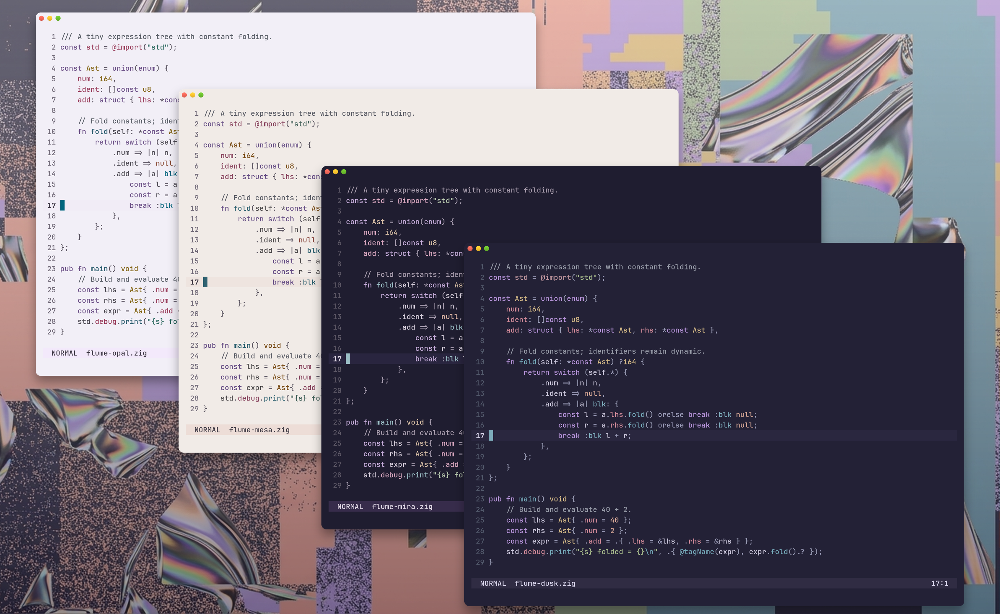

<p align="center">
  
  <br><br>
</p>

Flume is a Neovim colorscheme inspired by
[Jonathan Zawada's artwork for Flume](https://zawada.art/work/flume-skin/). It has two dark and two
light palettes, with optional matching themes for your terminal and developer tools.

The idea is to make code structure visible without coloring every identifier. Functions, types and
fields have distinct roles. Ordinary variables stay neutral, leaving room for selections, diffs and
diagnostics to stand out.



[Compare the palettes](docs/gallery.md) · [Why these colors?](docs/color-system.md)

## Install

Requires Neovim 0.9+ and a true-color terminal. Add this to your
[lazy.nvim](https://github.com/folke/lazy.nvim) configuration:

```lua
{
    "mitander/flume.nvim",
    version = "*",
    lazy = false,
    priority = 1000,
    config = function()
        vim.opt.termguicolors = true
        require("flume").setup({ schema = "dusk" })
    end,
}
```

Install the plugin and restart Neovim. Run `:echo g:colors_name` to confirm `flume-dusk`. `setup()`
applies the theme, so you don't need a separate `:colorscheme` call.

`version = "*"` follows release tags rather than commits on `master`. Updates become available
when a new release is tagged, and are installed when you update through lazy.nvim. To migrate an
existing installation, add this option to your Flume spec, remove any explicit `branch`, `tag` or
`commit` override, then run `:Lazy update flume.nvim`. If you already track unreleased `master`,
this can move you back to the latest release. Read that release's documentation before switching.
For a fixed version and appearance, use an exact tag such as `tag = "v0.2.0"` instead of `version`.

To opt into unreleased development changes, replace `version = "*"` with these fields in the same
spec:

```lua
version = false,
branch = "master",
```

Existing installations without a release constraint still follow their configured branch. This
README change does not switch them automatically.

With another plugin manager, select a release tag and put the two lines inside `config` in your
`init.lua` after the plugin loads. Tree-sitter parsers and language servers are optional. Flume
colors their output but does not install them.

## Palettes

A **palette** is a complete set of colors for code and editor UI. The `schema` option selects its
name. Each palette has a matching Neovim colorscheme name, such as `flume-dusk`.

| Palette                     | Background           | Color direction                                                  |
| --------------------------- | -------------------- | ---------------------------------------------------------------- |
| [Dusk](docs/themes/dusk.md) | Violet dark          | Amber types, teal functions, purple keywords and rose-red fields |
| [Opal](docs/themes/opal.md) | Lilac-tinted light   | Gold types, teal functions and purple keywords                   |
| [Mira](docs/themes/mira.md) | Deep violet dark     | Pastel teal, almond, lilac and dusty rose accents                |
| [Mesa](docs/themes/mesa.md) | Warm-neutral light   | Dark, low-saturation syntax colors                               |

They share the same role assignments. Choose by background and accent intensity, not by programming
language. See the [design explanation](docs/color-system.md#palette-direction) for the reasoning.

Palettes are still evolving. Pin a release tag or commit for a fixed appearance. Significant color
changes are recorded in the [changelog](CHANGELOG.md).

## Usage

Try another palette in the current editor:

```vim
:colorscheme flume-opal
```

Use `flume-dusk`, `flume-opal`, `flume-mira` or `flume-mesa`. To keep the choice at startup, change
`schema` in your setup. This switches the editor only, not external applications.

Upgrading an older configuration? `:help flume-migration` explains the compatibility entry
`colorscheme flume`, one-time option warnings and old extra paths
([online](doc/flume.txt)).

## Configuration

Keep your options in one `setup()` call. For example, use italic comments and make the current line
number follow the palette's accent:

```lua
require("flume").setup({
    schema = "dusk",
    styles = { comments = { italic = true } },
    highlights = {
        CursorLineNr = function(colors)
            return { fg = colors.accent, bold = true }
        end,
    },
})
```

Run `:set cursorline number` to see the line number. For transparency, role-color overrides and
other options, see `:help flume-options` ([online](doc/flume.txt)).

## Tweak a palette locally

Run `:FlumeTweak` to compare role-color edits in a scratch tab without changing your editor theme.
Use `h`/`l` for darker/lighter candidates, Enter for a hex color, `y` to copy edited
`schema_overrides`, and `q` to discard the draft. The [preview guide](docs/tweak.md) explains how to
keep an edit and what the samples show. Use `:FlumeTweakImport /path/to/draft.json` to audition a
whole set of role edits from a JSON file, including the
[Dusk plum draft example](examples/dusk-pastel.json). Local overrides do not change external themes.

## Integrations

### Neovim plugins

Flume defines highlight groups for supported plugins, including pickers, file trees, completion and
Git signs. Configure those plugins normally. They are not dependencies, and there is no extra
installation step for their highlights. See `:help flume-highlights` for the list.
For fzf.vim, use the [editor-local color recipe](docs/workflows.md#fzf-inside-neovim) to follow
colorscheme changes without copying hex values.

Lualine also has a named theme. Set `options = { theme = "flume" }` in your existing lualine
configuration. The theme follows palette changes. See `:help flume-lualine` for an example.

### External themes

Optional **extras** are theme files for Ghostty, Kitty, Tmux, LSD, OpenCode, Lazygit, Fish, fzf,
Delta and Pi. You can use a fixed palette or make configured applications follow a shared choice.
They are not required for the Neovim colorscheme.

Most extras use `:FlumeInstallExtras` with an application name. fzf and Delta use manual
configuration. The [setup and reload table](docs/workflows.md#external-tools) covers installation,
theme selection and reload behavior for every extra. Installing a file does not select its theme or
make the application reload. If you already use v0.2 extras, follow the
[migration guide](docs/semantic-export.md#migration-from-checkout-owned-state) to relink them.

Once the applications are configured, switch the editor and shared themes together:

```vim
:FlumeSync mira
```

Other running Flume editors follow the switch by default. Startup following is opt-in. To keep an
editor independent, set both `follow_sync = false` and `watch_sync = false`.
See `:help flume-follow_sync`. External themes use default palette colors, not editor-local overrides.

## Troubleshooting

Start with `:checkhealth flume`. For unexpected colors, startup issues or an application that keeps
the old palette, see `:help flume-troubleshooting` ([online](doc/flume.txt)).

## Documentation

- [Gallery](docs/gallery.md): compare palettes on code, editor states and external tools.
- [Color system](docs/color-system.md): design ideas, role meanings and contrast targets.
- [Preview guide](docs/tweak.md): explore and copy palette edits.
- [External-tool recipes](docs/workflows.md): install, select and reload matching themes.
- [Help reference](doc/flume.txt): all options and commands.
- [Semantic export](docs/semantic-export.md): use Flume colors in another application.

<a id="contributing"></a>

## Development

Start with [Contributing](CONTRIBUTING.md). [Development](docs/DEVELOPMENT.md) covers local loading,
reloads and artifact generation. [Testing](docs/TESTING.md) selects checks, and
[Showcase](docs/showcase.md) covers capture production. [Design](docs/DESIGN.md) and
[Style](STYLE.md) explain implementation responsibilities and conventions.

## License

MIT. See [LICENSE](LICENSE).
