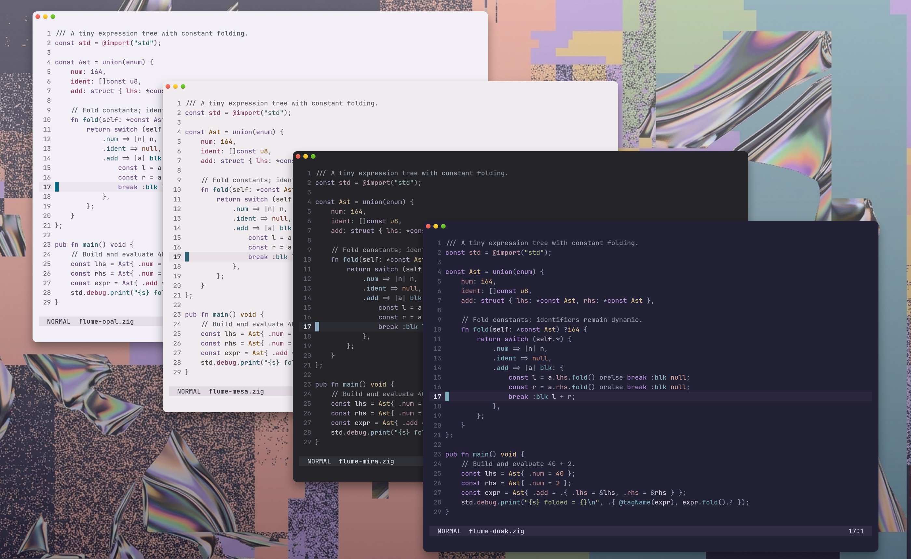

<p align="center">
  
  <br><br>
</p>

Flume is a Neovim colorscheme inspired by
[Jonathan Zawada's artwork for Flume](https://zawada.art/work/flume-skin/). It offers two dark and
two light palettes, with matching themes for your terminal and developer tools.

Ordinary identifiers stay neutral. Color distinguishes functions, types, selections, and diagnostics
against soft backgrounds.



[Compare palettes and browse language examples](docs/gallery.md).

> [!WARNING]
> Flume’s palettes are still evolving. Updates may change colors, including backgrounds. Significant
> visual changes are noted in the changelog. Pin the plugin to a release tag or commit if you want a
> fixed appearance.

## Install

Requires Neovim 0.9+ and a true-color terminal. Add this to your
[lazy.nvim](https://github.com/folke/lazy.nvim) configuration:

```lua
{
    "mitander/flume.nvim",
    lazy = false,
    priority = 1000,
    config = function()
        vim.opt.termguicolors = true
        require("flume").setup({
            schema = "dusk",
        })
    end,
}
```

Install the plugin and restart Neovim to load Dusk. Run `:echo g:colors_name` to confirm
`flume-dusk`. The `setup()` call applies the theme; you don't need an extra `:colorscheme` call.

With another plugin manager, install `mitander/flume.nvim`, then add the contents of the `config`
function above to your `init.lua` after the plugin loads.

Flume includes Tree-sitter, LSP, and plugin highlights. You'll need to install parsers and language
servers separately if you use them.

## Usage

Try another palette in the current editor:

```vim
:colorscheme flume-opal
```

The colorscheme names are `flume-dusk`, `flume-opal`, `flume-mira`, and `flume-mesa`. Change
`schema` in your setup to use that palette at startup.

## Configuration

For italic comments and a custom current line number, replace your setup call with:

```lua
require("flume").setup({
    schema = "opal",
    styles = {
        comments = { italic = true },
    },
    highlights = {
        CursorLineNr = {
            bold = true,
            fg = "#413b49",
        },
    },
})
```

Run `:set cursorline number` to see the line-number change. For all options, including palette-role
overrides, see `:help flume-options` ([online](doc/flume.txt)).

## Integrations

Follow the [external-tool recipes](docs/workflows.md#external-tools) to install and select a
matching theme.

For **lualine**, set `options = { theme = "flume" }` in your existing setup. The named theme follows
palette changes; see `:help flume-lualine`.

Matching themes are available for **Ghostty, Kitty, Tmux, LSD, OpenCode, Lazygit, Fish, fzf, Delta, and
Pi**. See `:help flume-extras` for supported installation paths and reload behavior.

Once they're configured, switch the editor and shared themes together:

```vim
:FlumeSync mira
```

Other running Flume editors follow the switch by default. External apps may need a reload or a new
invocation.

To remember the shared palette at startup, see `:help flume-follow_sync`. To keep an editor
independent, set both `follow_sync = false` and `watch_sync = false`.

## Troubleshooting

- `:help flume` for the full manual ([online](doc/flume.txt)).
- `:help flume-troubleshooting` to identify unexpected colors or palette switches.
- `:checkhealth flume` to verify your setup and integration files are correct.
- [Palette manifest](docs/palette-manifest.md) for color roles and values for overrides.

## Contributing

See the [contributor guide](docs/contributing.md) for local development, checks, and visual review.
The [changelog](CHANGELOG.md) records releases.

## License

MIT. See [LICENSE](LICENSE).
