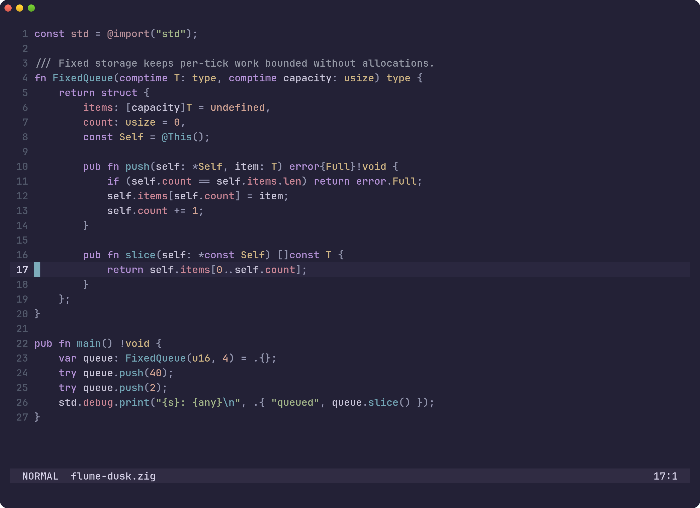
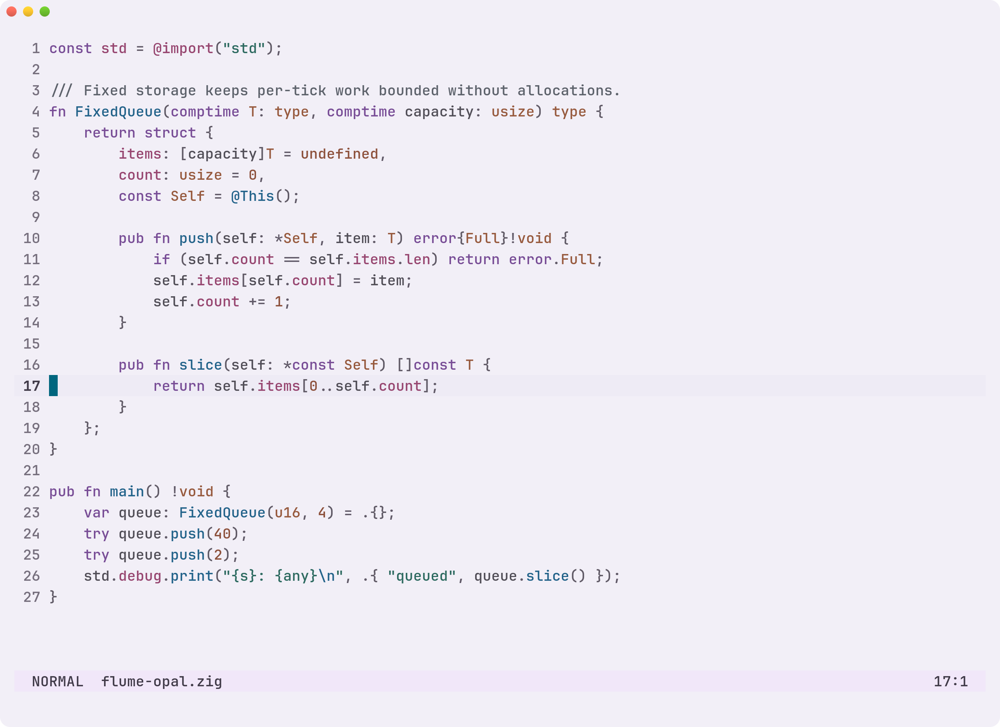
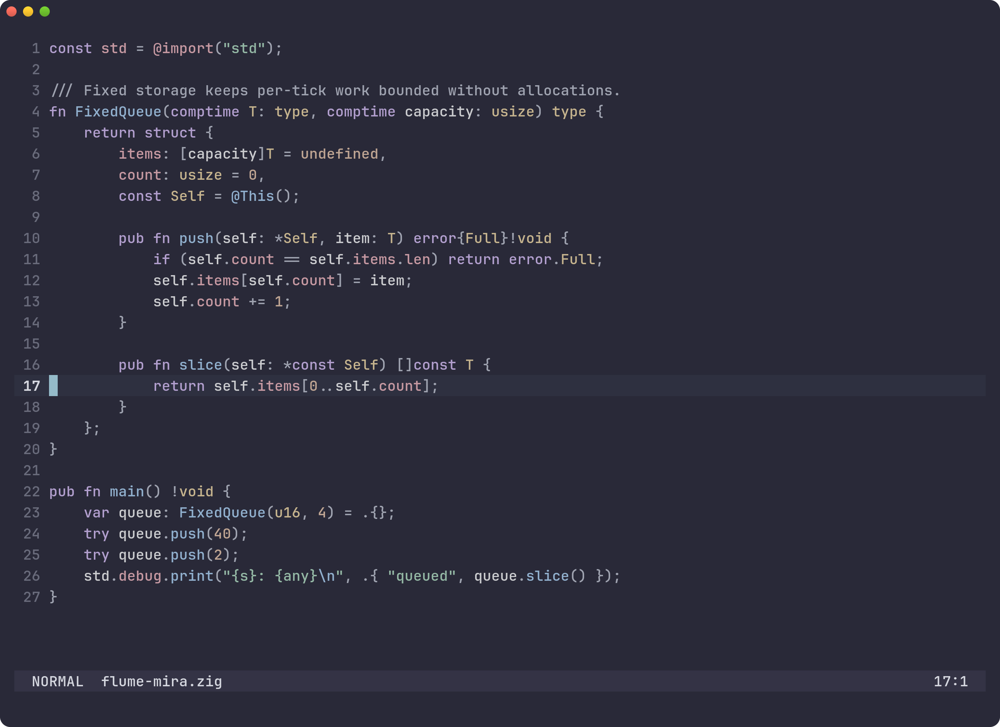
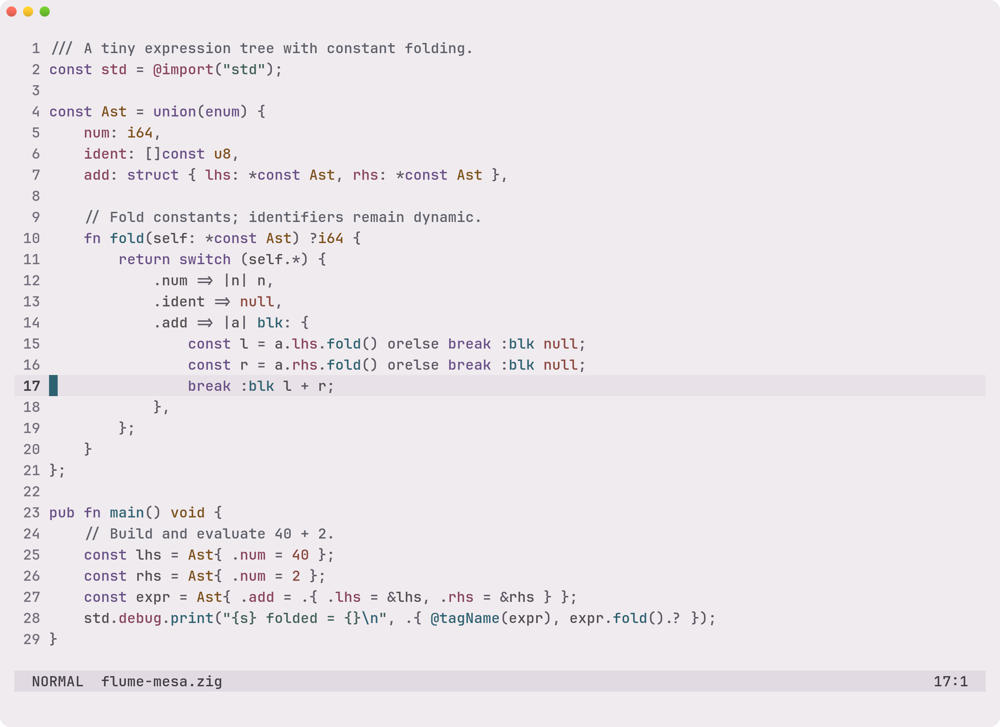

# Palette gallery

Choose a palette by comparing the same code on different backgrounds. All four use the same color
roles, so switching palettes does not change what a function, type or diagnostic means. Read
[the design explanation](color-system.md) for the reasoning.

## Browse by palette

Each preview shows the same Zig source with Tree-sitter. Click a preview or palette name for more
languages, selections, diffs, diagnostics, completion, Go/Zig LSP hover examples, lualine, Neo-tree,
and terminal-app snapshots. All maintained images use the same
[reproducible capture pipeline](showcase.md).

### [Dusk](themes/dusk.md)

Violet dark background with amber types, teal functions and lavender keywords.

### [Opal](themes/opal.md)

Lilac-tinted light background with apricot types, vivid violet keywords, blue calls and pink-berry fields.

### [Mira](themes/mira.md)

Lifted blue-violet dark background with softened text and matte honey, sky-blue and lavender accents.

### [Mesa](themes/mesa.md)

Faint violet-gray paper with ochre types, deeper violet keywords, petrol-blue calls and jade strings.

## Browse by language

Compare all four palettes on one page:

[Go](languages/go.md) · [Rust](languages/rust.md) · [Python](languages/python.md) ·
[TypeScript/TSX](languages/tsx.md) · [Zig](languages/zig.md) · [Elixir](languages/elixir.md) ·
[TOML](languages/toml.md)

Editor snapshots use real Tree-sitter and opaque backgrounds in Linux Ghostty. Your terminal, font,
transparency, and language tools can change the appearance.

[Install Flume](../README.md#install) · [Configure external tools](workflows.md) ·
[Refresh screenshots](showcase.md)
