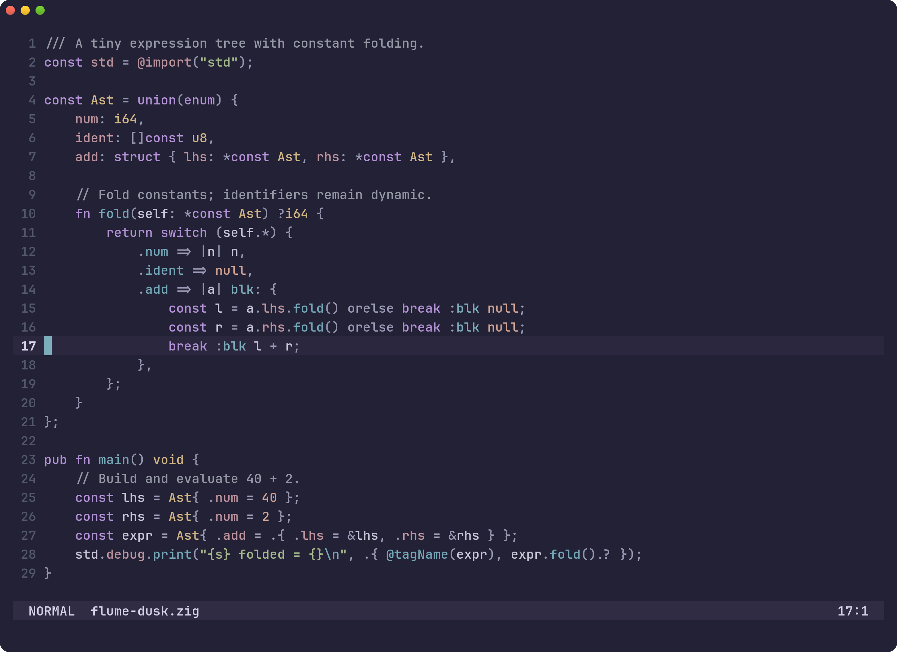
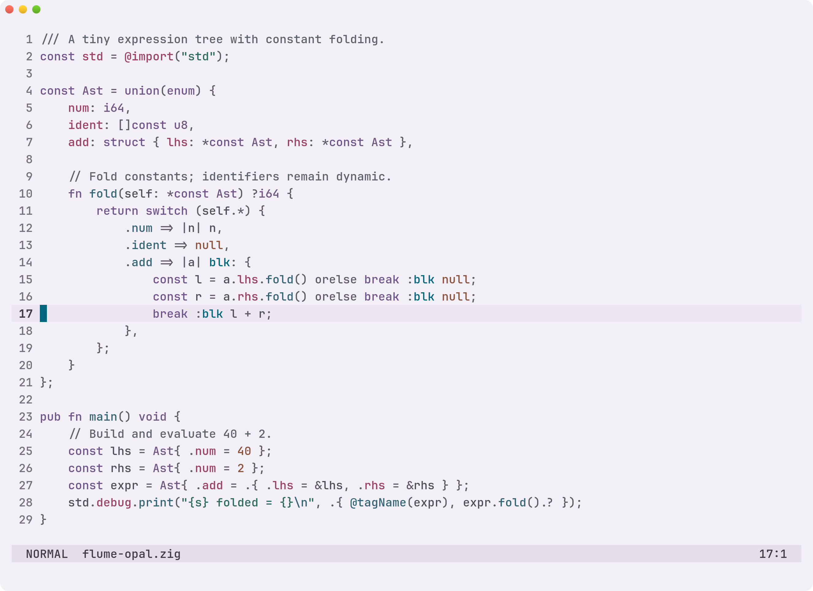
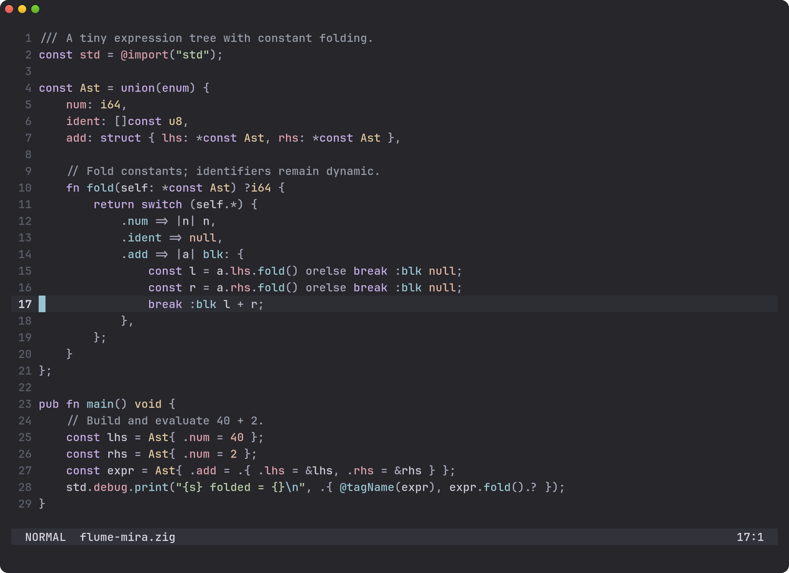
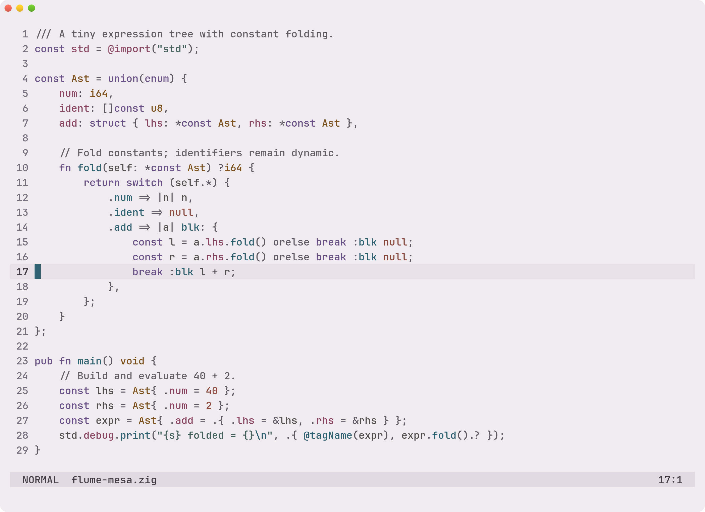

# Palette gallery

Compare Flume's two dark and two light palettes on the same code and editor states.

## Browse by palette

Each preview shows the same Zig source with Tree-sitter. Click a preview or palette name for more
languages, selections, diffs, diagnostics, completion, Go/Zig LSP hover examples, lualine, Neo-tree,
and terminal-app snapshots. All maintained images use the same
[reproducible capture pipeline](showcase.md).

### [Dusk](themes/dusk.md)

Dark, with a quiet violet canvas.

### [Opal](themes/opal.md)

Light, with purple, red, and sea-glass inks on cool porcelain paper.

### [Mira](themes/mira.md)

Dark, with a charcoal canvas and restrained mineral accents.

### [Mesa](themes/mesa.md)

Light, with restrained inks on soft rose-gray paper.

## Browse by language

Compare all four palettes on one page:

[Go](languages/go.md) · [Rust](languages/rust.md) · [Python](languages/python.md) ·
[TypeScript/TSX](languages/tsx.md) · [Zig](languages/zig.md) · [Elixir](languages/elixir.md) ·
[TOML](languages/toml.md)

Editor snapshots use real Tree-sitter and opaque backgrounds in Linux Ghostty. Your terminal, font,
transparency, and language tools can change the appearance.

[Install Flume](../README.md#install) · [Configure external tools](workflows.md) ·
[Refresh screenshots](showcase.md)
