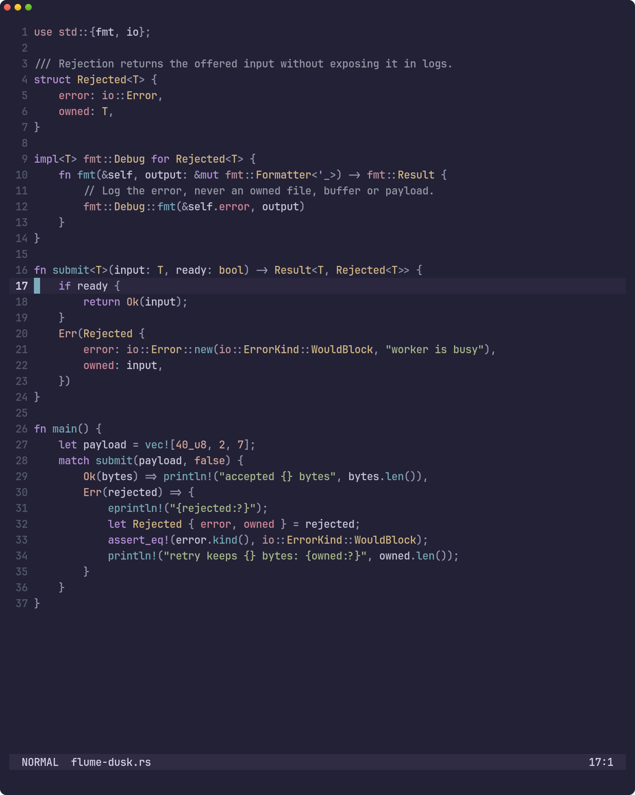
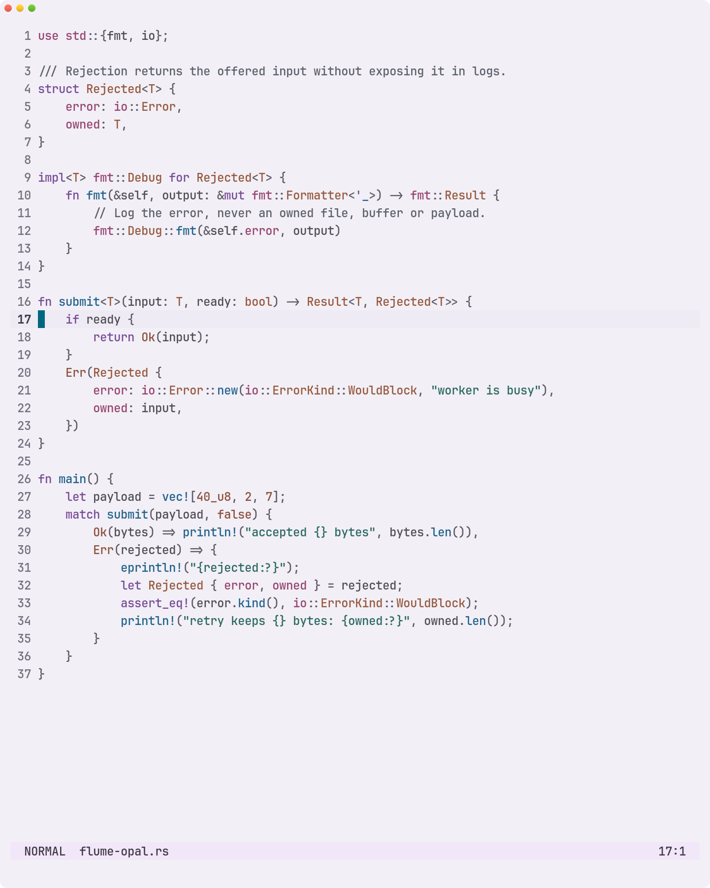
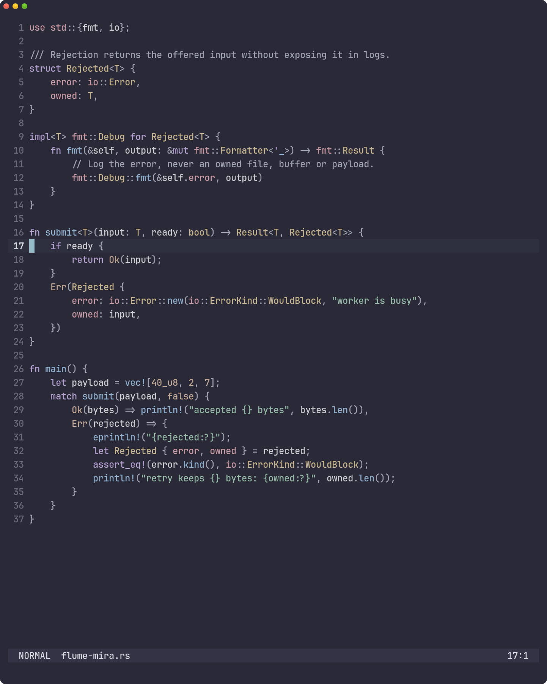
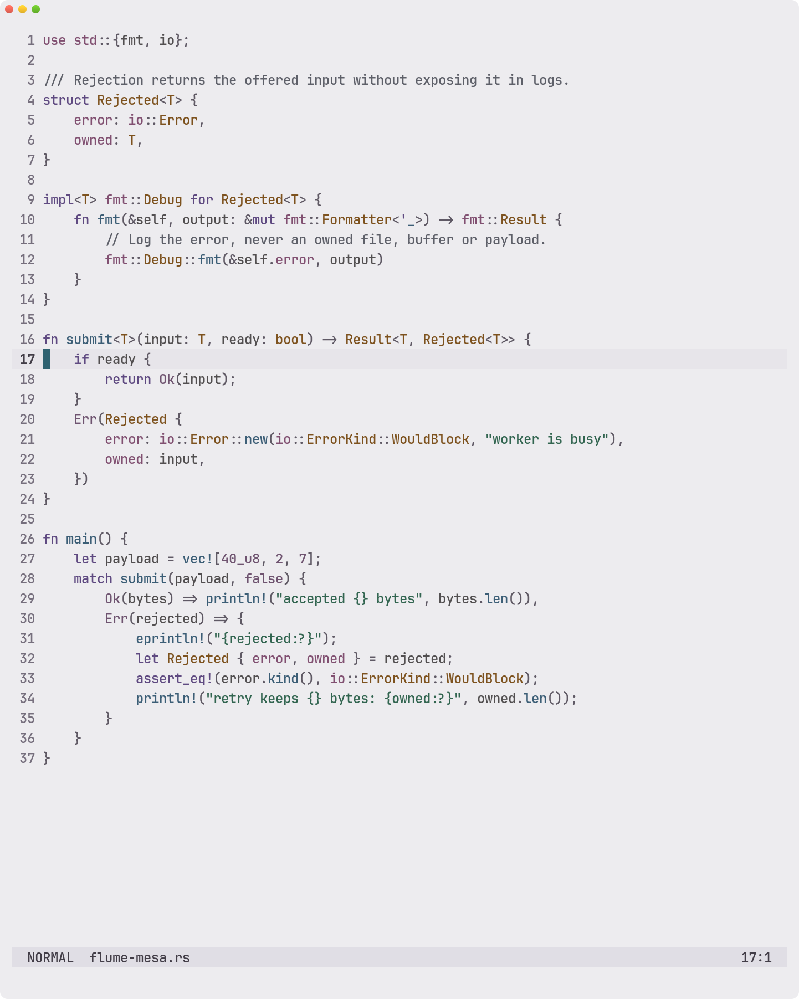

# Rust examples

The same Rust source and Tree-sitter runtime in all four palettes.
[Source and capture details](../showcase.md#code-examples).

These captures do not run rust-analyzer. The pinned Tree-sitter queries give type parameters such
as `T` the same accent as named types. LSP `typeParameter` tokens use neutral identifier ink instead,
while named types remain accented. See the [provider rules](../color-system.md#provider-alignment).

[Dusk](#dusk) · [Opal](#opal) · [Mira](#mira) · [Mesa](#mesa) · [All galleries](../gallery.md)

## Dusk

[More Dusk examples](../themes/dusk.md#rust)

## Opal

[More Opal examples](../themes/opal.md#rust)

## Mira

[More Mira examples](../themes/mira.md#rust)

## Mesa

[More Mesa examples](../themes/mesa.md#rust)

